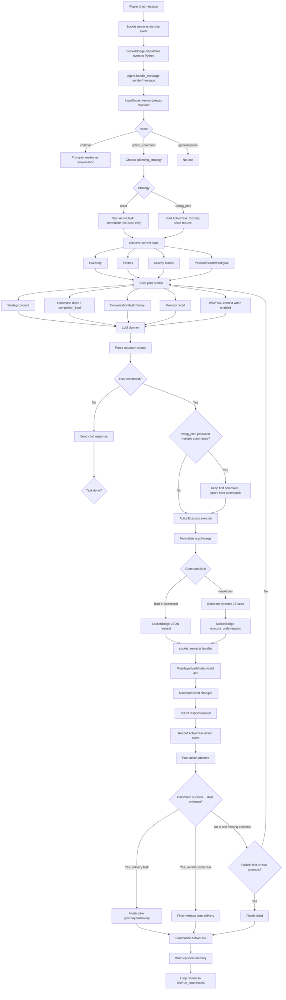
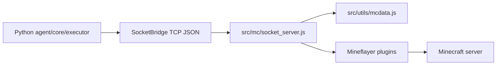

# Bot Command Flow

这张图描述一次玩家命令从 Minecraft 聊天进入，到 Python agent 规划、执行、观察、结束任务并写入记忆的完整链路。

## Key Points

- `InputRouter` 决定一句话是否应该进入执行链路；`DispatchGate` 可作为 LLM 分类器补充，但不可用时会回退到关键词路由。
- `InputRouter` 还会给 action task 打 `planning_strategy`：`react` 用于战斗、跟随、搜索、停止等高动态任务；`rolling_plan` 用于制作、烧炼、挖矿、种植、养动物等稳定流程。
- `rolling_plan` 不是 full plan。LLM 可以提前想 2-3 步，但只有第一条命令会执行；未来步骤必须是普通文字，执行后重新 `observe` 再决定是否保留或改写。
- `observe` 是规划的地基。每轮执行前后都会读取背包、实体、附近方块和基础状态，避免 LLM 只靠对话历史猜。
- `CommandDef.completion_kind` 告诉 loop 怎么判断结束：例如 `delivery` 依赖交付，`world_change`/`custom_action` 可以用状态证据结束，`query`/`navigation` 默认不直接完成任务。
- `newAction` 仍然通过 `socket_server.js` 执行，但只能使用动态 API 文档暴露的 `api.*` 方法，不应假设原生 Mindcraft 的 `skills.*` 对象存在。
- 任务结束后会写入 episodic memory；失败任务也会记录原因，后续 prompt 可引用这些经验。

## Minimal Runtime Boundary

当前 Python 版本只需要一层很薄的 Node/Mineflayer 桥：

原生 Mindcraft 的 JS agent、models、process、browser UI、profile runner 已不在主执行链路里。
