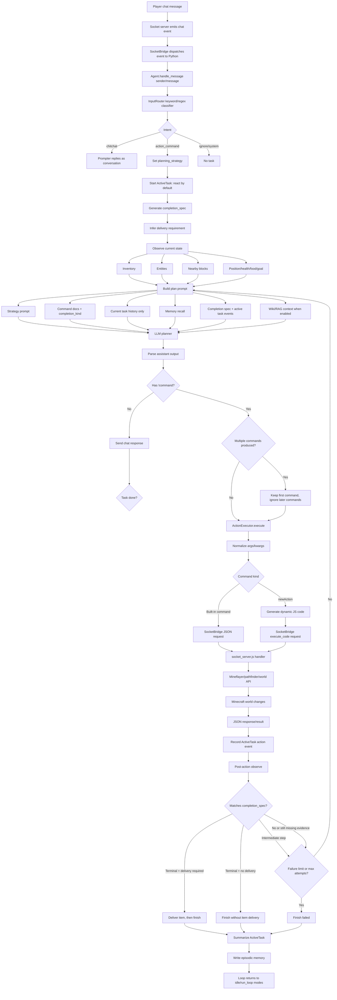
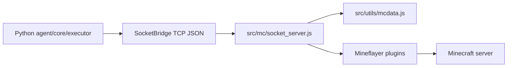

# Bot Command Flow

这张图描述一次玩家命令从 Minecraft 聊天进入，到 Python agent 规划、执行、观察、结束任务并写入记忆的完整链路。

## Key Points

- `InputRouter` 决定一句话是否应该进入执行链路；`DispatchGate` 可作为 LLM 分类器补充，但不可用时会回退到关键词路由。
- `InputRouter` 还会给 action task 打 `planning_strategy`，但现在默认统一使用 `react`。Minecraft 世界状态变化快，执行链路优先采用“观察 -> 执行一个命令 -> 再观察”的短循环。
- `rolling_plan` 仍保留在类型和执行保护里，方便以后做 opt-in 实验；当前路由层不会自动启用它。即使 LLM 输出多个命令，loop 也只保留第一条并在执行后重新 `observe`。
- `observe` 是规划的地基。每轮执行前后都会读取背包、实体、附近方块和基础状态，避免 LLM 只靠对话历史猜。
- `ActiveTask.completion_spec` 是任务成功边界。它在任务开始时生成，记录任务类型、目标物品、数量、可接受物品、terminal commands、intermediate commands，以及是否需要交付。
- `CommandDef.completion_kind` 只是命令级信号；最终能不能结束任务要先通过 `completion_spec`。例如 `挖8铁矿` 中 `craftRecipe("oak_planks")` 只是 intermediate，不能结束任务；只有收集到足量 `raw_iron`/`iron_ore` 后才算达成收集边界。
- 是否需要交付由 spec 的主判断和 `DispatchGate` 小模型信号联合决定。主判断权重更高，小模型只做校准；如果小模型不可用，则使用 spec 的本地判断。
- `newAction` 仍然通过 `socket_server.js` 执行，但只能使用动态 API 文档暴露的 `api.*` 方法，不应假设原生 Mindcraft 的 `skills.*` 对象存在。
- 任务结束后会写入 episodic memory；失败任务也会记录原因，后续 prompt 可引用这些经验。

## Minimal Runtime Boundary

当前 Python 版本只需要一层很薄的 Node/Mineflayer 桥：

原生 Mindcraft 的 JS agent、models、process、browser UI、profile runner 已不在主执行链路里。
