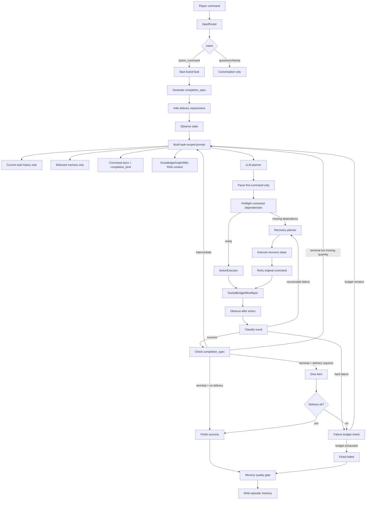

# Agent 任务完成与失败恢复实施方案

> **分支**: `refactor/stage-4-reliability`
> **前提**: Phase 1/2 agent 核心已完成，Stage 3 Wiki RAG/KnowledgeGraph 已能提供 Minecraft 静态知识

---

## 动机

06 解决的是“bot 如何获得 Minecraft 知识”，但最近日志暴露出另一个更关键的问题：**bot 知道事实以后，仍然会在执行层过早成功、过早失败、或被旧任务上下文带偏。**

典型问题：

| 问题 | 日志表现 | 根因 |
|---|---|---|
| 任务过早成功 | “种植 8 块田”只种 1 块就完成 | 没有任务级成功边界，只看命令成功 |
| 依赖缺失即失败 | 挖铁矿缺石镐后直接 `ActiveTask failed` | 失败分类没有区分可恢复依赖与真正失败 |
| 多任务互相污染 | 上一个任务的采集/制作意图进入新任务 | prompt/history/memory 没有严格按 ActiveTask 隔离 |
| 规划跑偏 | 造火把时优先找橡木、烧木炭，而不是用已有煤 | LLM 在缺少确定性 preflight 时自行补常识 |
| 世界任务无交付物 | 种植、繁殖、跟随、放置等任务无法用 “give item” 收尾 | completion 判断和 delivery 判断耦合过深 |

解决方案：**把任务成功边界、依赖恢复、交付判断、记忆写入从自然语言 prompt 中抽出来，变成结构化协议。**

---

## 设计目标

| 目标 | 说明 |
|---|---|
| 默认 ReAct | 每轮只执行一个命令，执行后重新 observe，再决定下一步 |
| 任务隔离 | 当前 ActiveTask 只读取本任务开始后的 history 和相关 memory |
| 明确成功边界 | 每个 ActiveTask 启动时生成 `completion_spec` |
| 交付独立判断 | 是否需要 give item 由 spec 主判断 + 小模型辅助判断联合决定 |
| 可恢复失败不终止 | 缺工具、缺材料、附近没有目标等先进入 recovery，而不是直接 failed |
| 结构化记忆 | 只把经过质量门控的任务结果写入 episodic memory |

---

## 总体架构



---

## 核心协议

### `CompletionSpec`

`CompletionSpec` 是每个玩家任务的结构化成功边界，在 ActiveTask 启动时生成。

```python
@dataclass
class CompletionSpec:
    kind: str
    target_items: tuple[str, ...] = ()
    acceptable_items: tuple[str, ...] = ()
    quantity: int | None = None
    terminal_commands: frozenset[str] = frozenset()
    intermediate_commands: frozenset[str] = frozenset()
    requires_delivery: bool = False
    delivery_score: float = 0.0
    delivery_reason: str = ""
```

任务示例：

| 玩家请求 | kind | target/quantity | terminal | intermediate | requires_delivery |
|---|---|---|---|---|---|
| `挖8铁矿` | `collect_item` | `raw_iron` / 8 | `collectBlocks`, `givePlayer` | `craftRecipe`, `searchForBlock` | true |
| `种8块小麦田` | `planting` | 8 plots | `tillAndSow` | `breakNearbyBlocks`, `collectBlocks` | false |
| `繁殖鸡` | `breeding` | none | `breedAnimals` | `collectBlocks`, `searchForEntity` | false |
| `跟我来` | `navigation` | none | `goToPlayer`, `followPlayer` | none | false |
| `做16火把` | `craft_item` | `torch` / 16 | `craftRecipe`, `givePlayer` | `collectBlocks`, `smeltItem` | true |

关键规则：

- `completion_kind` 是命令级信号，不能单独决定任务完成。
- `completion_spec` 是任务级边界，必须先匹配它。
- intermediate command 永远不能结束任务。
- terminal command 也必须满足数量、物品、世界状态证据。

---

## 失败分类

执行失败不应该立即等于任务失败。先把失败分为四类：

| 类型 | 示例 | 处理 |
|---|---|---|
| `missing_tool` | `Need a stone_pickaxe to mine iron_ore` | craft required tool，再 retry |
| `missing_material` | `Missing materials for torch: stick x2` | getCraftingPlan / collect / craft missing materials |
| `nearby_miss` | `No oak_log nearby` | 改用同类资源、扩大搜索、回到玩家附近 |
| `hard_failure` | bridge disconnected / command unknown | 计入失败预算，必要时终止 |

### 当前优先级

1. `missing_tool`
   - iron ore → stone/iron/diamond/netherite pickaxe
   - dirt/sand/gravel → shovel family
   - logs/planks/wooden blocks → axe family
2. `missing_material`
   - 缺 sticks → 用任意 log/planks 合成
   - 缺 cobblestone → 用已有 pickaxe 挖 stone
   - 缺 furnace/crafting_table → 先合成或放置工作站
3. `nearby_miss`
   - 泛化木头：无显式 oak 时允许任意 `*_log` / `*_stem`
   - 泛化煤：火把优先使用已有 coal，不主动烧 charcoal
   - 泛化矿石：允许 deepslate variant 作为 acceptable item

---

## RecoveryPlan

推荐增加一个轻量结构，避免 recovery 逻辑散落在 core loop 里：

```python
@dataclass
class RecoveryStep:
    command: str
    args: tuple[Any, ...] = ()
    kwargs: dict[str, Any] | None = None
    reason: str = ""

@dataclass
class RecoveryPlan:
    cause: str
    original_command: str
    original_args: tuple[Any, ...]
    steps: tuple[RecoveryStep, ...]
    retry_original: bool = True
```

示例：挖铁矿缺石镐。

```text
cause: missing_tool stone_pickaxe for iron_ore
steps:
  1. craftRecipe("stick", 1)
  2. craftRecipe("stone_pickaxe", 1)
retry:
  collectBlocks("iron_ore", 8)
```

Recovery 必须遵守三条约束：

- 有 recovery budget，避免无限修复。
- recovery step 记入 ActiveTask events，但不能替代原任务成功。
- retry 后仍然要走 `completion_spec` 验证。

---

## 任务隔离

### Prompt 隔离

每个 ActiveTask 记录 `history_start_index`。

构建 plan prompt 时：

- 只注入当前任务开始后的 user/assistant/system history。
- 不把上一任务的失败动作直接带入当前任务。
- 如果是导航任务，只允许导航相关 memory。

### Memory 隔离

任务结束写 memory 前先过质量门：

| 条件 | 写入策略 |
|---|---|
| status=success 且有 completion evidence | 正常写入 |
| status=failed 且有明确原因 | 写入低置信度 episodic |
| summary 与 events 矛盾 | 降低 confidence 或不写入 |
| 导航任务 | 只写位置/跟随/到达相关事实 |
| 中间步骤 | 不单独晋升为长期记忆 |

---

## 交付判断

以前的 loop 假设“任务完成 = 给玩家物品”，但这对种植、繁殖、跟随、放置类任务不成立。

新的判断方式：

```text
requires_delivery =
  0.70 * completion_spec.delivery_score
+ 0.30 * small_model_delivery_score
>= 0.50
```

主判断来自任务 spec，小模型只做校准：

| 请求 | 主判断 | 小模型作用 |
|---|---:|---|
| `给我8铁` | 高 | 可确认 direct item |
| `挖8铁矿` | 高 | 可确认需要交付 |
| `种8块田` | 低 | 即使小模型误判也不能强制交付 |
| `跟我来` | 极低 | 禁止被旧任务带成 give item |

---

## 从代码代理流程借鉴的部分

可以借鉴类似 Claude Code 的工作节奏，但不要照搬“一次完整计划”的形式：

| 代码代理流程 | Minecraft bot 对应 |
|---|---|
| 先读上下文 | 每轮 `observe()` + 当前任务 history |
| 做局部计划 | 默认 ReAct，一次只选一个命令 |
| 执行后看结果 | 每个 command 后立即 post-action observe |
| 遇到失败先修依赖 | missing tool/material recovery |
| 验证再结束 | completion_spec + state evidence |
| 写总结 | ActiveTask events → memory quality gate |

不适合照搬的部分：

- 不做 full plan。Minecraft 世界状态变化太快，完整计划容易过期。
- 不让 LLM 自己决定所有依赖。配方、工具等级、可采集物应该由 KnowledgeGraph 决定。
- 不让自然语言总结覆盖结构化事实。events/state 是 truth source，summary 只是说明。

---

## 实施阶段

### Stage 4a — ReAct 默认化 + 任务隔离

**目标**: 每个玩家任务只执行自己的上下文，不被上一个任务污染。

任务清单：

- [x] `InputRouter` 默认 `planning_strategy=react`
- [x] LLM 输出多个命令时只执行第一个
- [x] `ActiveTask.history_start_index`
- [x] plan prompt 只注入当前任务 history
- [x] 导航任务阻断 crafting/collecting bleed
- [ ] memory recall 按任务 kind 做更细粒度过滤

### Stage 4b — CompletionSpec

**目标**: 不再用“命令成功”直接结束任务。

任务清单：

- [x] ActiveTask 启动时生成 `completion_spec`
- [x] 支持 `navigation` / `collect_item` / `craft_item` / `cook_item` / `planting` / `breeding`
- [x] `挖8铁矿` 映射为 `raw_iron`，接受 `iron_ore` / `deepslate_iron_ore`
- [x] intermediate command 不可完成任务
- [x] planting 数量校验，避免种 1 块就结束 8 块任务
- [ ] 从 KnowledgeGraph 自动生成 alias/acceptable_items，减少手写别名

### Stage 4c — 可恢复失败

**目标**: 缺工具/缺材料时先修依赖再重试。

任务清单：

- [x] 识别 `Need a stone_pickaxe to mine iron_ore`
- [x] 自动 craft sticks / stone_pickaxe
- [x] retry 原始 `collectBlocks`
- [x] retry 后继续走 `completion_spec`
- [x] 支持 shovel/axe/hoe/sword 等工具族
- [x] 支持 wood/stone/iron/gold/diamond 等工具材料的基础依赖补齐
- [x] 支持 missing material 的常见材料解析与恢复
- [x] 支持 recovery budget 与 recovery loop guard
- [ ] 支持 netherite upgrade smithing 路径
- [ ] 支持更完整的 missing material 图搜索恢复

### Stage 4d — Preflight

**目标**: 在命令执行前就发现明显依赖问题，减少无意义失败。

任务清单：

- [x] `collectBlocks(block, count)` 前查 KnowledgeGraph 工具要求
- [x] `craftRecipe(item, count)` 前查材料和工作台需求
- [x] `smeltItem(item, fuel)` 前查输入、熔炉和燃料需求
- [x] 火把任务优先使用已有 `coal`，不主动烧 `charcoal`
- [x] 泛木材任务默认使用最近/已有任意木材，除非玩家明确说 `oak`
- [ ] 将 smelting recipe 从启发式表迁移到结构化 minecraft-data

### Stage 4e — Memory Quality Gate

**目标**: 失败、取消、中间步骤不会污染后续任务。

任务清单：

- [x] events/state 与 LLM summary 做一致性校验
- [x] completion evidence 不足时禁止写 success memory
- [x] failed memory 降低 confidence，并保留明确原因
- [x] 将 `task_failed` 记忆从默认 prompt 中降权，只在相关任务召回
- [x] 对导航任务、交付任务、世界变更任务写入 task kind/schema 标签
- [ ] 为不同 task kind 拆分独立 markdown 模板

### Stage 4f — 回归测试与评估

**目标**: 用真实失败日志构建回归集。

任务清单：

- [x] `挖8铁矿` 缺石镐 → craft stone_pickaxe → retry
- [x] `种8块小麦田` 不因 1 次 `tillAndSow` 完成
- [x] `跟我来` 不继承上一任务 crafting/collecting
- [ ] `尽量多造火把` 有 coal 时直接 craft torch
- [ ] `收集木头` 不强制 oak_log
- [ ] `繁殖鸡` 完成后不要求交付物品
- [ ] socket timeout 后主动 stop/release control state

---

## 文件结构

```text
mindcraft-py/
├── src/
│   ├── agent/
│   │   ├── core.py              # ActiveTask / CompletionSpec / recovery loop
│   │   └── executor.py          # command execution + completion_kind
│   ├── knowledge/
│   │   └── knowledge_graph.py   # recipes / tools / block materials / loot
│   └── llm/
│       └── input_router.py      # intent + planning_strategy
├── tests/
│   ├── test_agent_dynamic_modes.py
│   ├── test_input_router.py
│   └── test_knowledge_graph.py
├── docs/
│   └── bot-command-flow.md
└── roadmap/
    └── 07-task-completion-recovery-plan.md
```

---

## 验收标准

### 正确性

- `collect_item` 任务必须达到数量后才成功。
- `planting` / `breeding` / `navigation` 任务不要求交付物品。
- intermediate command 不能触发 ActiveTask success。
- 缺工具/缺材料类错误至少尝试一次确定性恢复。

### 稳定性

- 单个 ActiveTask 不能无限 recovery。
- socket timeout 后释放控制状态，避免 stuck。
- 新任务开始时取消旧任务，不允许旧 loop 继续写入同一个 active task。

### 可观测性

- 日志必须记录：
  - `completion_spec`
  - `delivery judgement`
  - `recovery cause`
  - `recovery steps`
  - `retry result`
  - `finish_reason`

### 测试

```bash
uv run pytest tests/test_agent_dynamic_modes.py -q
uv run pytest tests/test_input_router.py tests/test_knowledge_graph.py -q
uv run ruff check src/agent/core.py tests/test_agent_dynamic_modes.py
```

---

## 后续方向

| 方向 | 说明 |
|---|---|
| Skill precondition schema | 每个 skill 声明 required_items / required_blocks / produces |
| KnowledgeGraph planner | 用图搜索自动生成 `collect -> craft -> retry` 依赖链 |
| Recovery memory | 把成功恢复路径写成 procedural candidate，供后续复用 |
| Offline eval harness | 从日志切片自动生成回归用例 |
| RAG-assisted explanation | 失败后用 wiki/RAG 解释原因，但不让 RAG 直接决定事实 |

最终目标：LLM 负责理解玩家想要什么，KnowledgeGraph/CompletionSpec/RecoveryPlan 负责判断“现在能不能做、做完没有、失败后怎么修”。这样 bot 才能从“会说会试”升级成“稳定完成任务”。
