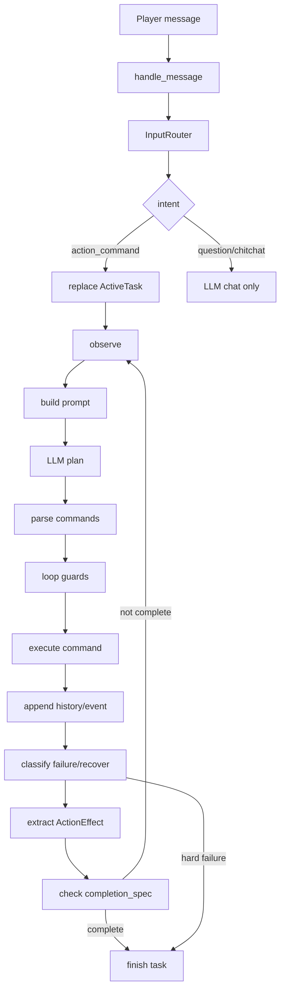
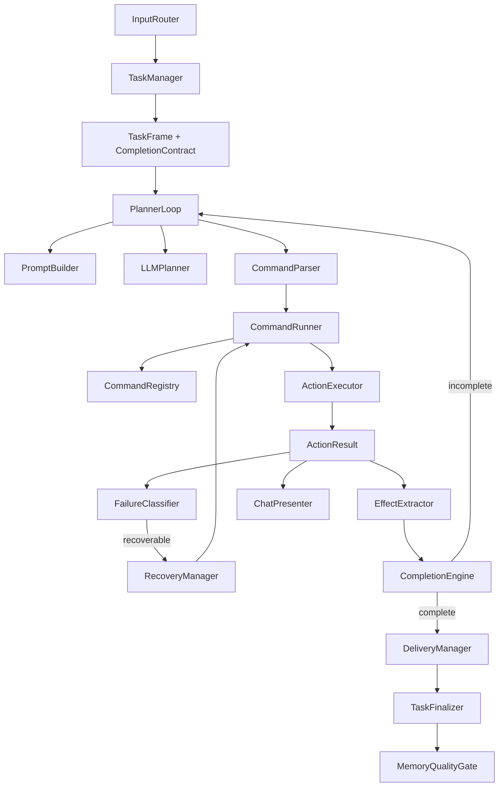

# Agent Loop 优化与解耦计划

> **目标分支**: `refactor/stage-5-agent-loop`
> **前置状态**: 07 已引入 `completion_spec`、任务隔离、失败恢复和初版 `ActionEffect`
> **核心目标**: 把 agent loop 从“巨型流程函数”拆成可测试、可替换、少硬编码的执行协议

---

## 背景

最近的日志暴露出一个更深层的问题：agent 已经不只是“LLM 生成命令然后执行”，而是在做一套完整任务系统。

当前 `src/agent/core.py` 同时承担了这些职责：

- 输入路由与任务启动
- prompt 构建与 LLM 调用
- 命令解析、过滤、执行
- 失败分类与恢复
- 任务完成判定
- 自动交付
- memory 写入质量门控
- 游戏内 chat 展示压缩

这些逻辑都集中在 `_run_plan_loop()` 和周边 helper 里，短期能跑，长期会导致：

- 完成条件不断新增特判
- recovery 规则散落在 loop 中
- command docs、completion kind、effect 提取分散维护
- 新增一个命令时要改很多位置
- 日志能看出问题，但代码边界不清晰

因此下一阶段要做的不是继续补单点 if/else，而是把 loop 拆成几个稳定协议。

---

## 当前流程



这个流程本身没问题，问题是大部分节点都写在同一个类里。

---

## 目标架构



目标不是把系统变复杂，而是让每个模块只回答一个问题：

| 模块 | 只负责 |
|---|---|
| `TaskManager` | 当前任务是谁、baseline 是什么、历史从哪里开始 |
| `PlannerLoop` | 推进一轮 observe-plan-act-check |
| `CommandRunner` | 运行命令并返回结构化结果 |
| `CommandRegistry` | 命令元信息、completion kind、preflight、effect extractor |
| `FailureClassifier` | 把失败文本/异常转成结构化失败原因 |
| `RecoveryManager` | 从失败原因生成恢复步骤 |
| `CompletionEngine` | 根据 contract + state + effects 判断是否完成 |
| `DeliveryManager` | 判断并执行交付 |
| `ChatPresenter` | 游戏内短消息，日志保留详情 |

---

## 核心协议

### 1. `ActionResult`

命令执行结果不能再只是字符串。字符串适合给 LLM 和日志看，但完成判定应该看结构化字段。

```python
@dataclass
class ActionResult:
    ok: bool
    command: str
    summary: str
    detail: str = ""
    effects: tuple[ActionEffect, ...] = ()
    failure: FailureCause | None = None
```

兼容策略：

- Phase 1 继续允许 executor 返回 `str`
- `CommandRunner` 把旧字符串包装成 `ActionResult`
- 新命令逐步直接返回 `ActionResult`

### 2. `ActionEffect`

`ActionEffect` 是完成判定的通用证据。

```python
@dataclass
class ActionEffect:
    type: Literal[
        "inventory_delta",
        "world_change",
        "delivery",
        "navigation",
        "interaction",
    ]
    name: str
    count: int = 1
    item: str | None = None
    position: tuple[float, float, float] | None = None
```

示例：

| 命令 | effect |
|---|---|
| `tillAndSow` | `world_change: planted_crop x1` |
| `givePlayer` | `delivery: iron_pickaxe x2` |
| `breedAnimals` | `interaction: animal_bred x1` |
| `goToPlayer` | `navigation: near_player x1` |
| `craftRecipe("torch", 8)` | `inventory_delta: torch +8` |

### 3. `CompletionContract`

用通用 contract 替代任务类型特判。

```python
@dataclass
class CompletionContract:
    target_type: Literal[
        "inventory_delta",
        "effect_count",
        "delivery",
        "navigation",
    ]
    targets: tuple[str, ...]
    quantity: int = 1
    requires_delivery: bool = False
    acceptable_items: tuple[str, ...] = ()
```

示例：

| 玩家请求 | contract |
|---|---|
| `种16块田` | `effect_count(planted_crop) >= 16` |
| `做两把铁镐` | `inventory_delta(iron_pickaxe) >= 2` + delivery |
| `挖8铁矿` | `inventory_delta(raw_iron/iron_ore) >= 8` + delivery |
| `跟我来` | `navigation(near_player) >= 1` |
| `繁殖鸡` | `effect_count(animal_bred) >= 1` |

---

## 需要去除或迁移的硬编码

| 当前位置 | 问题 | 目标去向 |
|---|---|---|
| `_COMMAND_COMPLETION_KINDS` | 命令完成类型集中硬编码 | `CommandRegistry` |
| `_ALWAYS_TERMINAL_WORLD_CHANGE_COMMANDS` | world change 是否 terminal 写死 | `CompletionEngine + contract` |
| `_CONDITIONAL_TERMINAL_WORLD_CHANGE_COMMANDS` | 任务边界逻辑膨胀 | `CommandRegistry.effect_policy` |
| `_ITEM_ALIAS_SOURCES` | 中英文物品别名堆在 core | `data/intent_aliases.json` 或 KnowledgeGraph |
| `_CRAFT_ALIASES` | crafting 别名硬编码 | `data/intent_aliases.json` |
| `_completion_spec_from_message` | 意图解析和 contract 生成混在一起 | `TaskGoalParser` |
| `_world_change_command_can_complete_task` | 按命令/任务写特判 | 删除，改用 effects |
| `_world_change_completion_has_required_progress` | 种田数量特判 | 删除，改用 `effect_count` |
| `_recover_missing_dependency` | 失败解析 + 恢复执行混在一起 | `FailureClassifier + RecoveryManager` |
| `_try_direct_item_request` | 直接快捷路径和 planner 竞争 | 收窄到“已有物品直接交付” |

---

## 分阶段实施

### 当前开发进度

- Phase 0 已完成：游戏内 chat 走 `ChatPresenter` 简短输出，完整命令结果保留在日志和事件里；结构化任务不会因为中间命令成功而直接完成。
- Phase 1 已完成：新增 `ActionResult` 和 `CommandRunner`，旧 executor 字符串会在命令执行边界包装成 `ok/summary/detail/effects/failure`。
- Phase 2 已完成：新增 `CompletionEngine`，种田、繁殖、交付、制作/采集增量统一走 `CompletionSpec + effects/state`；需要交付的任务必须看到 delivery effect 后才能成功；world-change 命令策略不再放在 `CompletionEngine` 中。
- Phase 3 已完成：`command_registry.py` 统一维护命令 docs、completion kind、terminal/intermediate policy、preflight hooks、shortcut eligibility；`core.py` 只保留兼容 wrapper 和执行逻辑。
- Phase 4 已完成：新增 `failures.py` 和 `recovery.py`，缺工具、缺材料、附近找不到、path timeout、bridge/hard failure 都会先转成 `FailureCause`；可恢复失败由 `RecoveryManager` 生成恢复/重规划步骤，bridge/hard failure 进入玩家介入路径。
- Phase 5 已完成：新增 `task_goal_parser.py` 和 `data/agent/intent_aliases.json`，中英文别名、数量解析、玩家说法到 `CompletionSpec` 的映射已从 `core.py` 迁出。
- Phase 6 已完成：新增 `task_manager.py`、`planner_loop.py` 和 `chat_presenter.py`；任务栈、baseline、completion spec、游戏内短消息、observe-plan-act-check 主循环都已从 `core.py` 迁出，`core._run_plan_loop_impl` 只保留兼容 wrapper。

### Phase 0: 稳定现状

目标：不大改行为，先防止继续出现假成功。

- loop 结束时，明确 contract 未满足必须 `failed/incomplete`
- 游戏 chat 只显示简要状态，完整结果写日志
- 成功 memory 必须有 completion evidence 或 delivery/effect evidence

验收：

- `种16块田` 只完成 5 块不能标成功
- `做两把铁镐` 没交付不能标成功
- `searchForBlock` 不能完成 world task

### Phase 1: 引入 `ActionResult` 兼容层

新增文件：

- `src/agent/action_result.py`
- `src/agent/effects.py`

实现：

- `ActionResult.from_legacy(command, result_str)`
- `ActionEffect` 从 core 移出
- `CommandRunner` 负责把 executor 字符串包装成 `ActionResult`

验收：

- 现有 executor 不需要一次性重写
- completion 不再直接读大段 `result_str`
- chat presenter 读 `summary`
- logger/event 读 `detail`

### Phase 2: 建立 `CompletionEngine`

新增文件：

- `src/agent/completion.py`

职责：

- `contract_satisfied(task, state) -> bool`
- `progress(task, state) -> CompletionProgress`
- `should_finish_after_action(task, result, state) -> FinishDecision`

删除/弱化：

- `_completion_spec_allows_command_completion`
- `_world_change_completion_has_required_progress`
- `_world_change_command_can_complete_task`

验收：

- 种田、繁殖、交付、制作、采集都走同一套 `CompletionEngine`
- 新增世界类任务时只需要提供 effect，不需要改 loop

### Phase 3: Command Registry 合并命令元数据

新增文件：

- `src/agent/command_registry.py`

每个命令声明：

```python
CommandMeta(
    name="tillAndSow",
    category="world_change",
    terminal_by_default=False,
    effects=[EffectTemplate("world_change", "planted_crop", count=1)],
    preflight=None,
)
```

迁移内容：

- command docs
- completion kind
- effect extractor
- preflight hook
- shortcut eligibility

验收：

- 新增命令只改 registry 和 executor
- core 不再维护多个命令名字集合

### Phase 4: FailureClassifier 与 RecoveryManager

新增文件：

- `src/agent/failures.py`
- `src/agent/recovery.py`

结构：

```python
@dataclass
class FailureCause:
    kind: str
    target: str | None = None
    required: str | None = None
    missing: dict[str, int] = field(default_factory=dict)

@dataclass
class RecoveryPlan:
    cause: FailureCause
    steps: tuple[RecoveryStep, ...]
    retry_original: bool = True
```

迁移：

- `Need a stone_pickaxe to mine iron_ore`
- `Missing materials for torch: stick x2`
- `No oak_log nearby`
- path timeout
- bridge/hard failure

验收：

- 缺石镐不会直接失败，会生成 craft stone_pickaxe plan
- 缺 stick 会优先用已有 logs/planks
- nearby miss 会有限次 fallback，不无限搜索

### Phase 5: TaskGoalParser 与别名数据化

新增：

- `src/agent/task_goal_parser.py`
- `data/agent/intent_aliases.json`

目标：

- 把中英文别名移出 `core.py`
- 把“玩家说法 -> contract”集中管理
- 后续可接 KnowledgeGraph/RAG 辅助解析，但 deterministic 规则优先

验收：

- `铁镐`、`火把`、`种田` 等别名不再散落在 core
- 添加新别名不需要改 Python 代码

### Phase 6: 拆分 PlannerLoop

新增：

- `src/agent/planner_loop.py`
- `src/agent/task_manager.py`
- `src/agent/chat_presenter.py`

`core.Agent` 保留：

- 生命周期
- bridge/memory/prompter wiring
- handle_message 入口

迁出：

- plan loop 主体
- command running
- completion check
- recovery
- chat compaction

验收：

- `core.py` 明显变薄
- `_run_plan_loop()` 不再超过约 150 行
- loop 每个阶段可以单测

---

## 测试计划

### 必须保留的回归测试

- `种16块田` 只完成部分不能成功
- `种1块田` 成功后可以完成
- `做两把铁镐` 需要新增数量 + 交付
- `挖8铁矿` 缺石镐要 recovery
- `searchForBlock` 不能完成非导航任务
- `breakNearbyBlocks` 清草不能完成种田任务
- `givePlayer` 前必须 `goToPlayer`
- LLM 生成 `!stop` 但玩家没要求 stop 时必须拦截

### 新增测试类别

| 类别 | 示例 |
|---|---|
| `ActionResult` | legacy string -> structured result |
| `EffectExtractor` | 命令结果 -> effects |
| `CompletionEngine` | effects/state -> complete/incomplete |
| `FailureClassifier` | error text -> FailureCause |
| `RecoveryManager` | FailureCause -> RecoveryPlan |
| `CommandRegistry` | 所有命令都有 meta/effect/completion kind |

---

## 迁移原则

1. 每个 phase 都必须保持现有动态测试通过。
2. 不一次性重写 executor，先通过 legacy adapter 兼容字符串结果。
3. 任何新增 hardcoded rule 都要优先放 registry/data 文件，不再塞进 `core.py`。
4. LLM prompt 只能作为规划辅助，不能作为完成判定的唯一依据。
5. 成功条件必须可复盘：日志里能看到 baseline、effects、contract、final decision。

---

## 完成标准

这个 roadmap 完成后，系统应该达到：

- 新增一个 command 时，只需要：
  - executor handler
  - command registry meta
  - 可选 effect extractor/preflight
- 新增一个任务类型时，只需要：
  - goal parser 生成 contract
  - 命令产生对应 effects
- agent loop 不知道“种田/铁镐/繁殖鸡”的细节
- 任务完成由 `CompletionEngine` 统一判断
- 失败恢复由 `RecoveryManager` 统一处理
- 游戏内 chat 简短，日志完整

最终目标是让 agent 从“LLM 驱动的一串命令”升级为“有任务合同、状态证据和恢复策略的执行系统”。
